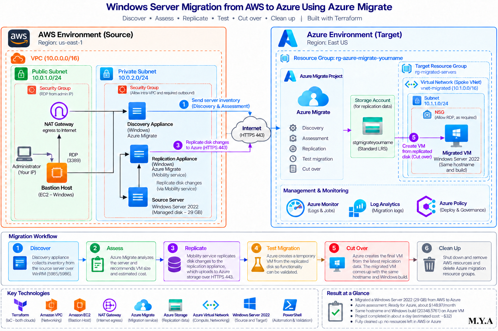

# Windows Server Migration from AWS to Azure Using Azure Migrate

This project moves a Windows Server running on AWS into Azure using Microsoft's Azure Migrate service. It covers finding the server, checking that it is ready, copying its disk to Azure, testing the copy, and switching over.

> **Status:** In progress. The plan, architecture, and steps are written. Screenshots and results get added as I build it.

### 🎬 Video Walkthrough

---

## Project Overview

### What this project does, in plain English

Think of it like moving house. Before you move, someone walks through your current home and writes down what you have (**discovery**). Then they tell you how big the new place needs to be and what it will cost (**assessment**). The movers start packing and shipping your things while you keep living there (**replication**). You visit the new place once to make sure everything arrived and works (**test migration**). Then you hand over the keys and move in for good (**cutover**).

That is the whole project. The "house" is a Windows Server on AWS, and the "new place" is a virtual machine in Azure.

Where the analogy breaks down: in a real move your old house is empty afterward. Here, the AWS server keeps running until you shut it down, and Azure keeps copying any changes until the moment you switch.

### Why it matters

Companies move servers between clouds all the time: to cut costs, to meet compliance rules, or because they bought a company that runs on a different platform. Knowing how to plan and run that move, and how to check that nothing broke, is a core skill for cloud and infrastructure roles.

### What gets built

- **On AWS:** a network (VPC), one Windows Server 2022 instance to migrate, and two helper servers (appliances) that Azure Migrate needs.
- **On Azure:** a landing network, a storage account that holds the copied data, an Azure Migrate project, and finally the migrated VM.
- **Both sides are built with Terraform** in two separate folders, so each cloud can be torn down on its own.

### Skills demonstrated

- Cloud-to-cloud migration with Azure Migrate: discover, assess, replicate, test, cut over
- Infrastructure as Code with Terraform across two providers (AWS and Azure)
- AWS networking: VPC, subnet, internet gateway, route table, security groups
- Azure networking: resource groups, VNet, subnet, NSG
- Firewall rules scoped to exactly the traffic the migration needs
- Planning a test migration before cutover to lower risk
- Clean teardown across two clouds to stop charges

---

## Project Structure

```
aws-to-azure-migrate/
├── README.md
├── architecture.drawio        # editable diagram (open in draw.io)
├── images/
│   ├── architecture.png       # exported from draw.io
│   └── ...                    # screenshots, named by step
├── aws-side/
│   ├── main.tf
│   ├── variables.tf
│   ├── outputs.tf
│   └── terraform.tfvars       # NOT committed (contains passwords)
├── azure-side/
│   ├── main.tf
│   ├── variables.tf
│   ├── outputs.tf
│   └── terraform.tfvars       # NOT committed
└── .gitignore
```

---

## Architecture Diagram




### How it works

1. **Discover.** The discovery appliance (a helper server inside AWS) logs into the source server over WinRM and collects its details: OS, CPU, memory, disks.
2. **Assess.** The appliance sends that inventory to the Azure Migrate project. Azure checks for blockers and recommends a VM size and monthly cost.
3. **Replicate.** A small agent called the Mobility service runs on the source server. It sends disk changes to the replication appliance, which uploads them to a storage account in Azure.
4. **Test.** Azure builds a temporary VM from the copied disk so I can confirm it boots, then deletes it.
5. **Cut over.** Azure builds the final VM from the latest copy. That VM is the migrated server.

### Key terms

| Term | What it means |
|---|---|
| **Azure Migrate** | Microsoft's service for moving servers into Azure. It tracks every step in one project. |
| **Appliance** | A helper server that runs Azure Migrate software. This project uses two: one for discovery, one for replication. |
| **Mobility service** | A small agent installed on the server being moved. It watches the disk and sends changes. |
| **Replication** | Continuously copying the server's disk to Azure while the server keeps running. |
| **Cutover** | The final switch, when the Azure copy becomes the real server. |
| **VPC / VNet** | A private network in the cloud. VPC is AWS's name, VNet is Azure's. |
| **Security group / NSG** | A firewall that decides which traffic is allowed in or out. Security group is AWS's name, NSG is Azure's. |

---

## Prerequisites

- An AWS account and an Azure subscription
- Terraform, AWS CLI, and Azure CLI installed locally
- A Remote Desktop client (Microsoft Remote Desktop on Mac, `mstsc` on Windows)
- About 4–6 hours, mostly waiting on replication

Check both clouds are connected before starting:

```bash
aws sts get-caller-identity
az account show
```

Both should return account details with no errors.

---

## Naming Conventions Used

| Resource | Value |
|---|---|
| AWS VPC | `vpc-migrate-manuel` (10.0.0.0/16) |
| AWS subnet | `snet-migrate-manuel` (10.0.1.0/24) |
| Source server | `ec2-migrate-source-manuel` (Windows Server 2022, t3.medium) |
| Security group | `migrate-source-sg-manuel` (AWS blocks names starting with `sg-`) |
| Azure staging resource group | `rg-migrate-staging-manuel` |
| Azure target resource group | `rg-migrate-target-manuel` |
| Azure VNet | `vnet-migrate-manuel` (10.1.0.0/16) |
| Azure subnet | `snet-migrate` (10.1.1.0/24) |
| Replication storage | `stmigratemanuel` |
| Azure Migrate project | `migrate-project-manuel` |
| Regions | AWS `us-east-1`, Azure `East US` |
| Tags | `project = azure-migrate-lab`, `owner = manuel`, `managed_by = terraform` |

The two networks use different address ranges (10.0.x.x and 10.1.x.x) so they never overlap if a VPN is added later.

---

## What I'm Changing from the Base Lab

While reading the base lab against Microsoft's documentation for AWS migrations, I found a few things that would cause the build to fail or that describe the process incorrectly. These are the changes I'm making:

1. **It's agent-based, not agentless.** Microsoft treats AWS servers as physical servers. That means the Mobility service agent has to be installed on the source server. The base lab says nothing gets installed on the source, which isn't accurate for AWS.
2. **The appliances move into the AWS network.** Microsoft requires the source server to have a direct network path to the replication appliance (ports 443 and 9443). The base lab puts both appliances in Azure with no VPN, which would block replication. Placing them in the same AWS VPC as the source server fixes that.
3. **No AWS access keys for Azure Migrate.** Discovery for AWS servers uses the server's Windows login over WinRM, not AWS API keys. I'm removing the IAM user, access keys, and snapshot permissions, which also removes an unneeded credential.
4. **Security group rules match the real traffic.** RDP from my IP only, WinRM 5985 from the discovery appliance, and 443 + 9443 from the source server to the replication appliance. Nothing else open inbound.
5. **Clearer resource group name.** The base lab's Azure group is called "source," which is confusing since the source is in AWS. I renamed it to "staging."
6. **Small fixes:** security group name no longer starts with `sg-`, the appliance VM name matches across steps, and the teardown no longer refers to a CLI-built VM that Terraform now manages.

---

## Cost Estimate

The base lab estimates **about $5–8** if everything is built and destroyed within one day. Moving the appliances to AWS changes the mix, so I'll update this with my actual bill after the build.

**Destroy everything as soon as you finish.** Two clouds billing at once adds up quickly.

---

## Project Steps

Screenshot notes are marked with 📸. Save them in `images/` using the suggested file names.

### Step 1: Set Up the Project Folders

Create two Terraform folders so each cloud can be built and destroyed separately:

```bash
mkdir aws-to-azure-migrate && cd aws-to-azure-migrate
mkdir aws-side azure-side images
```

Add `terraform.tfvars`, `*.tfstate`, and `.terraform/` to `.gitignore` before writing any code. The tfvars files hold passwords.

📸 **Screenshot `01-folder-structure.png`:** your terminal or file explorer showing the `aws-side` and `azure-side` folders.

---

### Step 2: Build the AWS Side

`aws-side/main.tf` creates:

- The VPC, subnet, internet gateway, and route table
- The source Windows Server (the one being migrated)
- Two more Windows servers: the **discovery appliance** and the **replication appliance**
- Security groups with the rules from the changes list above

Deploy it:

```bash
cd aws-side
terraform init
terraform plan
terraform apply
```

Windows servers take a few extra minutes to finish starting after `apply` completes.

📸 **Screenshot `02-aws-apply.png`:** the `Apply complete! Resources: X added` line.
📸 **Screenshot `03-aws-ec2-console.png`:** the AWS EC2 console showing all three instances in the **Running** state.

---

### Step 3: Confirm the Source Server Works

Connect with Remote Desktop to the source server's public IP (`terraform output ec2_public_ip`), user `Administrator`, and the password from `terraform.tfvars`.

This is the "before" picture. Note the hostname and OS version so you can compare later.

📸 **Screenshot `04-source-server-desktop.png`:** the Windows Server desktop, ideally with **System → About** open showing the hostname and OS version.

---

### Step 4: Build the Azure Side

`azure-side/main.tf` creates the staging resource group, the VNet and subnet, the storage account for replication, the target resource group, and the NSG for the migrated VM.

```bash
cd ../azure-side
terraform init
terraform plan
terraform apply
```

📸 **Screenshot `05-azure-apply.png`:** the `Apply complete!` line.
📸 **Screenshot `06-azure-resource-groups.png`:** the Azure portal showing both resource groups and what's inside them.

---

### Step 5: Create the Azure Migrate Project

Terraform can't create an Azure Migrate project, so this one is done in the portal:

1. Search **Azure Migrate** → **Create project**
2. Resource group: `rg-migrate-staging-manuel`
3. Name: `migrate-project-manuel`, Geography: United States

📸 **Screenshot `07-migrate-project.png`:** the project's overview page.

---

### Step 6: Set Up the Discovery Appliance

1. In the Migrate project, go to **Discover**, choose **Physical or other (AWS, GCP, etc.)**, name the appliance, and click **Generate key**. Save the key.
2. Remote Desktop into the discovery appliance EC2 instance. Download and extract the installer, then run `AzureMigrateInstaller.ps1` as Administrator and choose **Physical or other**, **Azure Public**, **Public endpoint**.
3. In the configuration manager that opens, paste the project key and sign in to Azure to register.
4. Add a credential: type **Windows Server**, user `Administrator`, and the source server's password.
5. Add the source server's **private IP** as the discovery source (both are in the same VPC), then click **Start discovery**.

📸 **Screenshot `08-appliance-registered.png`:** the configuration manager showing "Successfully registered."
📸 **Screenshot `09-discovery-validated.png`:** the discovery source showing "Validation successful."
📸 **Screenshot `10-discovered-servers.png`:** Azure Migrate's discovered servers list with the source server in it.

---

### Step 7: Run the Assessment

1. In the Migrate project, click **Assess → Azure VM**
2. Settings: East US, performance-based sizing, no reserved instances
3. Create a group called `aws-ec2-group`, add the source server, and create the assessment

What to look for:
- **Readiness:** "Ready for Azure" means no blockers. "Ready with conditions" or "Not ready" lists what needs fixing.
- **Recommended VM size** and **monthly cost estimate**

Skip **Create wave**. That's for moving hundreds of servers in batches.

📸 **Screenshot `11-assessment-readiness.png`:** the readiness result.
📸 **Screenshot `12-assessment-size-cost.png`:** the recommended size and cost estimate.

---

### Step 8: Set Up the Replication Appliance

1. In the Migrate project, go to **Migration and modernization → Discover**, choose **Physical or other**, target region East US, and click **Create resources**. Azure creates the vault it needs here.
2. Download the replication appliance installer and its registration key.
3. Remote Desktop into the replication appliance EC2 instance, run the installer as Administrator, and register it with the key.

Microsoft says the replication appliance can't be the same machine as the discovery appliance, which is why there are two.

📸 **Screenshot `13-replication-appliance-registered.png`:** the replication appliance showing as connected.

---

### Step 9: Install the Mobility Service on the Source Server

1. On the replication appliance, generate the Mobility service configuration file.
2. Remote Desktop into the source server, copy over the agent installer and the configuration file, and install it.
3. Register the agent with the replication appliance.

This is the agent that sends disk changes. Without it, the source server won't show up when you click **Replicate**.

📸 **Screenshot `14-mobility-agent-installed.png`:** the install completing on the source server.

---

### Step 10: Start Replication

1. **Migration and modernization → Replicate**
2. Choose **Physical or other**, pick the replication appliance, and select the source server
3. Target: `rg-migrate-target-manuel`, storage `stmigratemanuel`, VNet `vnet-migrate-manuel`, subnet `snet-migrate`
4. Accept the recommended VM size, add the `project` tag, and click **Replicate**

The first full copy takes roughly 30–60 minutes for a 30 GB disk. Wait for the status to change from **Initial replication** to **Protected**.

📸 **Screenshot `15-replication-in-progress.png`:** the replicating machines list showing progress.
📸 **Screenshot `16-replication-protected.png`:** the status showing **Protected**.

---

### Step 11: Run a Test Migration

1. Open the replicating server and click **Test migration**, using `vnet-migrate-manuel`
2. When the test VM appears, connect to it and confirm Windows boots and the hostname matches
3. Click **Clean up test migration**

This is the dress rehearsal. Skipping it in a real migration is how outages happen.

📸 **Screenshot `17-test-vm-booted.png`:** the test VM's desktop or the VM page showing it running.
📸 **Screenshot `18-test-cleanup.png`:** the cleanup confirmation.

---

### Step 12: Cut Over

1. Open the replicating server and click **Migrate**
2. For a lab, choose **No** on shutting down the source. In production you'd shut it down so both copies aren't in use at once.

📸 **Screenshot `19-cutover-complete.png`:** the migration job showing completed.

---

### Step 13: Verify the Migrated VM

1. In `rg-migrate-target-manuel`, find the new VM
2. Attach a public IP and the NSG `nsg-migrate-target-manuel` to its network interface
3. Connect with Remote Desktop using the original `Administrator` password
4. Confirm the hostname and OS version match what you noted in Step 3

The IP address will be different from AWS. That's expected when changing clouds.

📸 **Screenshot `20-migrated-vm-desktop.png`:** the migrated VM's **System → About** page, side by side with Step 3's screenshot if possible. This is the most important screenshot in the project.

---

### Step 14: Tear Everything Down

Order matters:

1. **Stop replication** in Azure Migrate and wait for it to confirm
2. `terraform destroy` in `aws-side`
3. Delete `rg-migrate-target-manuel` (it holds the migrated VM, which Terraform doesn't track)
4. `terraform destroy` in `azure-side`
5. Delete the Azure Migrate project and the vault Azure created, if they remain

📸 **Screenshot `21-aws-destroyed.png`:** `Destroy complete!` for AWS.
📸 **Screenshot `22-azure-cleanup.png`:** the Azure resource groups list with the lab groups gone.

---

## Results

*To be filled in after the build.*

| Check | Result |
|---|---|
| Source server discovered | ☐ |
| Assessment readiness | ☐ |
| Recommended Azure VM size | ☐ |
| Estimated monthly cost in Azure | ☐ |
| Time for initial replication | ☐ |
| Test migration booted | ☐ |
| Cutover completed | ☐ |
| Hostname and OS match source | ☐ |
| Actual total cost (AWS + Azure) | ☐ |

**What I'd note in this section:** anything that broke, what fixed it, and how long each phase actually took compared to the estimates.

---

## Security Decisions

- **RDP limited to my IP.** Open RDP to the internet is one of the most scanned ports. Even for a short lab, there's no reason to allow it from everywhere.
- **Only the ports the migration needs.** WinRM (5985) for discovery and 443/9443 for replication, each allowed only from the specific appliance that uses it.
- **No AWS access keys.** Azure Migrate doesn't need them for AWS servers, so creating them would just add a long-lived credential that could leak.
- **Passwords stay out of Git.** `terraform.tfvars` and state files are in `.gitignore`. State files can contain sensitive values.
- **Test before cutover.** A test migration confirms the server boots in Azure before anything is committed.
- **Separate staging and target resource groups.** Migration tooling can be deleted without touching the migrated VM.

---

## Troubleshooting / Common Issues

| Issue | Cause | Fix |
|---|---|---|
| `cannot begin with sg-` | AWS reserves that prefix for its own IDs | Name the group `migrate-source-sg-manuel` |
| `collecting instance settings: empty result` | AMI ID doesn't exist in your region | Look up the latest Windows Server 2022 AMI with `aws ec2 describe-images` and update `windows_ami` |
| `azurerm_migrate_project` not supported | Terraform's Azure provider can't create Migrate projects | Create the project in the portal (Step 5) |
| Discovery validation fails | WinRM blocked, or wrong password | Check the security group allows 5985 from the discovery appliance, and re-enter the credential |
| Source server missing from the Replicate list | Mobility service not installed or not registered | Repeat Step 9 and confirm the agent shows up on the replication appliance |
| Replication stuck at 0% | Source can't reach the replication appliance | Confirm 443 and 9443 are allowed from the source to the replication appliance |
| Can't RDP to the migrated VM | No public IP or no NSG on its network interface | Attach both (Step 13) |
| Migrated VM has a different IP | Azure assigns a new address | Expected. Update DNS if anything points to the old IP |
| `vault is not empty` on destroy | Replication items still registered | Stop replication and remove items from the vault, then retry |

---

## Key Takeaways

These are the ideas this project is built to show. I'll revise them after the build based on what actually happened.

- **A migration is a process, not a button.** Discover, assess, replicate, test, cut over. Each step catches a different kind of problem.
- **Assessment is where you find blockers cheaply.** Fixing a "Not ready" result before replication saves hours.
- **Network paths decide whether it works.** The source server has to reach the replication appliance. Getting the firewall rules and placement right matters more than any setting in the portal.
- **Always test first.** A test migration costs minutes. A failed cutover can cost a day of downtime.
- **Clean up in order.** Two clouds and several manual resources mean `terraform destroy` alone won't catch everything.

---

## Reference

- [Microsoft: Discover, assess, and migrate AWS VMs to Azure](https://learn.microsoft.com/azure/migrate/tutorial-migrate-aws-virtual-machines)
- [Microsoft: Migrate machines as physical servers to Azure](https://learn.microsoft.com/azure/migrate/tutorial-migrate-physical-virtual-machines)
- Base lab guide: *Azure Migration Lab: AWS EC2 to Azure using Azure Migrate*

---
Author:** Manuel Yannick Armah

**Project:** Migrating a Windows Server from AWS to Azure with Azure Migrate

**Difficulty:** Intermediate

**Time to Complete:** 4–6 hours
