# Windows Server Migration from AWS to Azure Using Azure Migrate

I moved a live Windows Server 2022 from AWS to Azure using Microsoft's Azure Migrate. I discovered the server, assessed it, copied its disk, tested the copy, cut over, and then tore both clouds down. The migrated VM came up with the same hostname and the same Windows build as the original, and both sides are built with Terraform.


### 🎬 Video Walkthrough
[Watch the project walkthrough](PASTE-LOOM-LINK-HERE)


### Result at a glance

| | |
|---|---|
| **What I moved** | A Windows Server 2022 machine (29 GB disk) from AWS to an Azure VM |
| **Azure's assessment** | Ready for Azure, no blockers, about $148.97 a month |
| **Proof it worked** | Same hostname and same Windows build (20348.5761) on the Azure VM as on the AWS server |
| **Time and cost** | About a day, most of it troubleshooting. Projected cost of the whole lab: about $32 |
| **Cleanup** | Verified: nothing left running in AWS, and the migration resource groups are deleted in Azure |
| **Tools** | Terraform, AWS, Azure Migrate, PowerShell |

<!-- When the Loom is recorded, replace this comment with:
### 🎬 Video Walkthrough
[Watch the walkthrough](PASTE-LOOM-LINK-HERE)
-->

---

## Project Overview

### What this project does, in plain English

Think of it like moving house. Before you move, someone walks through your current home and writes down what you have (**discovery**). Then they tell you how big the new place needs to be and what it will cost (**assessment**). The movers start packing and shipping your things while you keep living there (**replication**). You visit the new place once to make sure everything arrived and works (**test migration**). Then you hand over the keys and move in for good (**cutover**).

That is the whole project. The "house" is a Windows Server on AWS, and the "new place" is a virtual machine in Azure.

Where the analogy breaks down: in a real move your old house is empty afterward. Here, the AWS server keeps running until you shut it down, and Azure keeps copying any changes until the moment you switch.

### Why it matters

Companies move servers between clouds all the time: to cut costs, to meet compliance rules, or because they bought a company that runs on a different platform. Knowing how to plan and run that move, and how to check that nothing broke, is a core skill for cloud and infrastructure roles.

### What gets built

- **On AWS:** a network (VPC), one Windows Server 2022 instance to migrate, and two helper servers (appliances) that Azure Migrate needs.
- **On Azure:** a landing network, a storage account that holds the copied data, an Azure Migrate project, and finally the migrated VM.
- **Both sides are built with Terraform** in two separate folders, so each cloud can be torn down on its own.

### Skills demonstrated

- Planning and running a cloud-to-cloud migration end to end: discover, assess, replicate, test, cut over
- Infrastructure as Code with Terraform across two providers, in separate folders so each cloud can be destroyed on its own
- AWS and Azure networking (VPC, subnets, routing, security groups, NSGs) and firewall rules limited to the traffic the migration needs
- Finding the real cause behind vague errors by reading service logs and job detail, not just the portal message
- Working through account quotas in both clouds, including requesting and getting an AWS vCPU increase
- Reading vendor requirements closely, such as the replication appliance counting physical cores, not vCPUs
- Choosing a VM size that matches the source's boot type (BIOS means a Generation 1 VM)
- Testing before cutover, and a cleanup that was checked rather than assumed

---

## Project Structure

```
aws-to-azure-migrate/
├── README.md
├── architecture.drawio        # editable diagram (open in draw.io)
├── images/
│   └── ...                    # screenshots, named by step
├── aws-side/
│   ├── main.tf
│   ├── variables.tf
│   ├── outputs.tf
│   └── terraform.tfvars       # NOT committed (contains passwords)
├── azure-side/
│   ├── main.tf
│   ├── variables.tf
│   ├── outputs.tf
│   └── terraform.tfvars       # NOT committed
└── .gitignore
```

---

## Architecture Diagram


### How it works

1. **Discover.** The discovery appliance (a helper server inside AWS) logs into the source server over WinRM and collects its details: OS, CPU, memory, disks.
2. **Assess.** The appliance sends that inventory to the Azure Migrate project. Azure checks for blockers and recommends a VM size and monthly cost.
3. **Replicate.** A small agent called the Mobility service runs on the source server. It sends disk changes to the replication appliance, which uploads them to a storage account in Azure.
4. **Test.** Azure builds a temporary VM from the copied disk so I can confirm it boots, then deletes it.
5. **Cut over.** Azure builds the final VM from the latest copy. That VM is the migrated server.

### Key terms

| Term | What it means |
|---|---|
| **Azure Migrate** | Microsoft's service for moving servers into Azure. It tracks every step in one project. |
| **Appliance** | A helper server that runs Azure Migrate software. This project uses two: one for discovery, one for replication. |
| **Mobility service** | A small agent installed on the server being moved. It watches the disk and sends changes. |
| **Replication** | Continuously copying the server's disk to Azure while the server keeps running. |
| **Cutover** | The final switch, when the Azure copy becomes the real server. |
| **VPC / VNet** | A private network in the cloud. VPC is AWS's name, VNet is Azure's. |
| **Security group / NSG** | A firewall that decides which traffic is allowed in or out. Security group is AWS's name, NSG is Azure's. |

---

## Prerequisites

- A **paid** AWS account and an Azure subscription. The AWS free plan could not launch instances big enough for Microsoft's appliance minimums.
- Terraform, AWS CLI, and Azure CLI installed locally
- A Remote Desktop client (Microsoft Remote Desktop on Mac, `mstsc` on Windows)
- Room in your vCPU quotas (see below)
- About a day. Replication itself is short, but expect to spend time troubleshooting.

**Check your quotas first.** This is the most common thing that stops a migration project:
- A new AWS account allows only **5 Standard vCPUs**. This build needs about 26 at once, so I requested an increase to 32 (Service Quotas, approved quickly).
- My Azure subscription allowed **4 vCPUs** in East US, which is enough for one small VM but not for large default sizes.

Check both clouds are connected before starting:

```bash
aws sts get-caller-identity
az account show
```

Both should return account details with no errors.

---

## Run It Yourself

1. Copy the example variable files and fill them in:
   ```bash
   cp aws-side/terraform.tfvars.example aws-side/terraform.tfvars
   cp azure-side/terraform.tfvars.example azure-side/terraform.tfvars
   ```
2. In `aws-side/terraform.tfvars`, set `my_ip_cidr` to your public IP with `/32` (find it with `curl https://checkip.amazonaws.com`) and choose an `admin_password`: 8 or more characters, at least 3 of upper case, lower case, digit and symbol, and avoid `"`, `$` and the backtick. A weak password does not stop the build, you just can't log in afterwards.
3. In `azure-side/terraform.tfvars`, set `subscription_id` (`az account show --query id -o tsv`) and the same `my_ip_cidr`.
4. Follow the steps below. Never commit `terraform.tfvars`. It is in `.gitignore` because it holds a password.

---

## Naming Conventions Used

| Resource | Value |
|---|---|
| AWS VPC | `vpc-migrate-kweku` (10.0.0.0/16) |
| AWS subnet | `snet-migrate-kweku` (10.0.1.0/24) |
| Source server | `ec2-migrate-source-kweku` (Windows Server 2022, t3.medium) |
| Security group | `migrate-source-sg-kweku` (AWS blocks names starting with `sg-`) |
| Azure staging resource group | `rg-migrate-staging-kweku` |
| Azure target resource group | `rg-migrate-target-kweku` |
| Azure VNet | `vnet-migrate-kweku` (10.1.0.0/16) |
| Azure subnet | `snet-migrate` (10.1.1.0/24) |
| Replication storage | `stmigratekweku` |
| Azure Migrate project | `migrate-project-kweku` |
| Regions | AWS `us-east-1`, Azure `East US` |
| Tags | `project = azure-migrate-lab`, `owner = kweku`, `managed_by = terraform` |

The two networks use different address ranges (10.0.x.x and 10.1.x.x) so they never overlap if a VPN is added later.

---

## What I'm Changing from the Base Lab

While reading the base lab against Microsoft's documentation for AWS migrations, I found a few things that would cause the build to fail or that describe the process incorrectly. These are the changes I made:

1. **It's agent-based, not agentless.** Microsoft treats AWS servers as physical servers. That means the Mobility service agent has to be installed on the source server. The base lab says nothing gets installed on the source, which isn't accurate for AWS.
2. **The appliances move into the AWS network.** Microsoft requires the source server to have a direct network path to the replication appliance (ports 443 and 9443). The base lab puts both appliances in Azure with no VPN, which would block replication. Placing them in the same AWS VPC as the source server fixes that.
3. **No AWS access keys for Azure Migrate.** Discovery for AWS servers uses the server's Windows login over WinRM, not AWS API keys. I'm removing the IAM user, access keys, and snapshot permissions, which also removes an unneeded credential.
4. **Security group rules match the real traffic.** RDP from my IP only, WinRM 5985 from the discovery appliance, and 443 + 9443 from the source server to the replication appliance. Nothing else open inbound.
5. **Clearer resource group name.** The base lab's Azure group is called "source," which is confusing since the source is in AWS. I renamed it to "staging."
6. **Small fixes:** security group name no longer starts with `sg-`, the appliance VM name matches across steps, and the teardown no longer refers to a CLI-built VM that Terraform now manages.

---

## What I Actually Built

The plan above changed once it met real quotas and requirements. This is what I ran.

| Item | Planned | What I ran | Why |
|---|---|---|---|
| AWS account | free plan | **new paid account** | The free plan could not launch instances big enough for Microsoft's appliance minimums |
| Discovery appliance | m5.2xlarge | m5.2xlarge | 8 vCPU / 32 GB |
| Replication appliance | c5.2xlarge | **c5.4xlarge** | The installer counts **physical cores**. 8 vCPUs is only 4 cores (hyperthreading), so it needs 16 vCPUs |
| Replication cache disk | 300 GB | **620 GB** | The installer aborts without about 600 GB free |
| AWS vCPU limit | 5 (new account) | raised to **32** | 8 + 16 + 2 vCPUs does not fit in 5 |
| Azure VM size | assessment pick | **D2s_v4** | The source boots BIOS, so Azure builds a Generation 1 VM. v6 and v7 sizes only boot Generation 2 |
| Azure vCPU quota | | 4 in East US | The wizard's default size (M8-2ms) would exceed it |

---

## Cost

**Projected cost of the whole lab: about $32.** This is a projection from AWS's published Windows hourly rates and how long each server ran, not a bill. Neither cloud's billing had posted when I finished, and I'm labelling it that way on purpose.

| Item | About how long | Rate (per hour) | Projected cost |
|---|---|---|---|
| Source server (`t3.medium`) | 17 hours | $0.06 | $1.00 |
| Discovery appliance (`m5.2xlarge`) | 15 hours | $0.752 | $11.60 |
| Replication appliance, `c5.2xlarge` first | 10.5 hours | $0.708 | $7.40 |
| Replication appliance, then `c5.4xlarge` | 6 hours | $1.416 | $8.80 |
| Disks (850 GB total, about a day) | 24 hours | gp3 storage | $2.30 |
| Public IPs and data out | | | $0.30 |
| **AWS total** | | | **about $31** |
| Azure: test VM plus the final VM (`D2s_v4`, Windows) | about 5.5 hours | about $0.19 | about $1 |
| **Everything** | | | **about $32** |

Why it was higher than the $5–8 the base lab suggests: the helper servers have to be large (the replication appliance alone is a 16 vCPU machine), and they ran for about a day, partly because of troubleshooting. I stopped the servers overnight, which cut the bill, but the disks kept billing.

**After cutover**, Azure's assessment estimated the migrated VM at about **$148.97 a month**. That includes the Windows license, because I left Azure Hybrid Benefit off. That figure is a monthly estimate for running it, not what this lab cost.

**Destroy everything as soon as you finish.** Two clouds billing at once adds up quickly.

---

## Project Steps

### Step 1: Set Up the Project Folders

Create two Terraform folders so each cloud can be built and destroyed separately:

```bash
mkdir aws-to-azure-migrate && cd aws-to-azure-migrate
mkdir aws-side azure-side images
```

Add `terraform.tfvars`, `*.tfstate`, and `.terraform/` to `.gitignore` before writing any code. The tfvars files hold passwords.

*Your terminal or file explorer showing the `aws-side` and `azure-side` folders.*

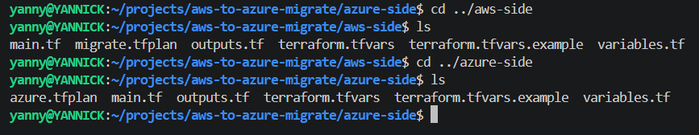


---

### Step 2: Build the AWS Side

`aws-side/main.tf` creates:

- The VPC, subnet, internet gateway, and route table
- The source Windows Server (the one being migrated)
- Two more Windows servers: the **discovery appliance** and the **replication appliance**
- Security groups with the rules from the changes list above

Deploy it:

```bash
cd aws-side
terraform init
terraform plan
terraform apply
```

Windows servers take a few extra minutes to finish starting after `apply` completes.

*The VPC `vpc-migrate-kweku` and its resource map: one subnet in `us-east-1a`, the route tables, and the internet gateway.*

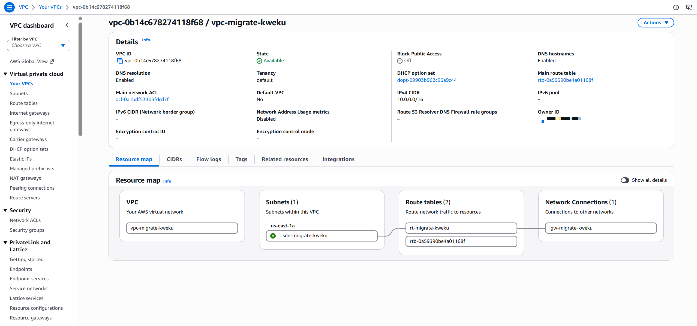

*The AWS EC2 console showing all three instances in the **Running** state.*

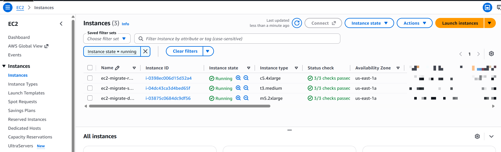


---

### Step 3: Confirm the Source Server Works

Connect with Remote Desktop to the source server's public IP (`terraform output ec2_public_ip`), user `Administrator`, and the password from `terraform.tfvars`.

This is the "before" picture. Note the hostname and OS version so you can compare later.

*The Windows Server desktop, ideally with **System → About** open showing the hostname and OS version.*

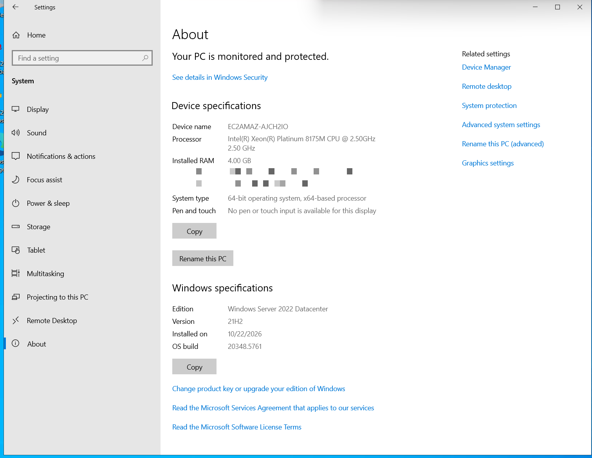


---

### Step 4: Build the Azure Side

`azure-side/main.tf` creates the staging resource group, the VNet and subnet, the storage account for replication, the target resource group, and the NSG for the migrated VM.

```bash
cd ../azure-side
terraform init
terraform plan
terraform apply
```

*The `Apply complete!` line.*

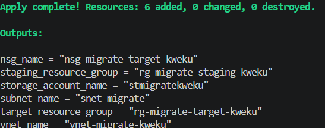

*The Azure portal showing both resource groups and what's inside them.*

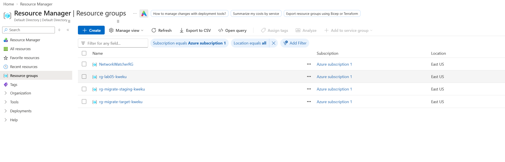


---

### Step 5: Create the Azure Migrate Project

Terraform can't create an Azure Migrate project, so this one is done in the portal:

1. Search **Azure Migrate** → **Create project**
2. Resource group: `rg-migrate-staging-kweku`
3. Name: `migrate-project-kweku`, Geography: United States

*The project's overview page.*

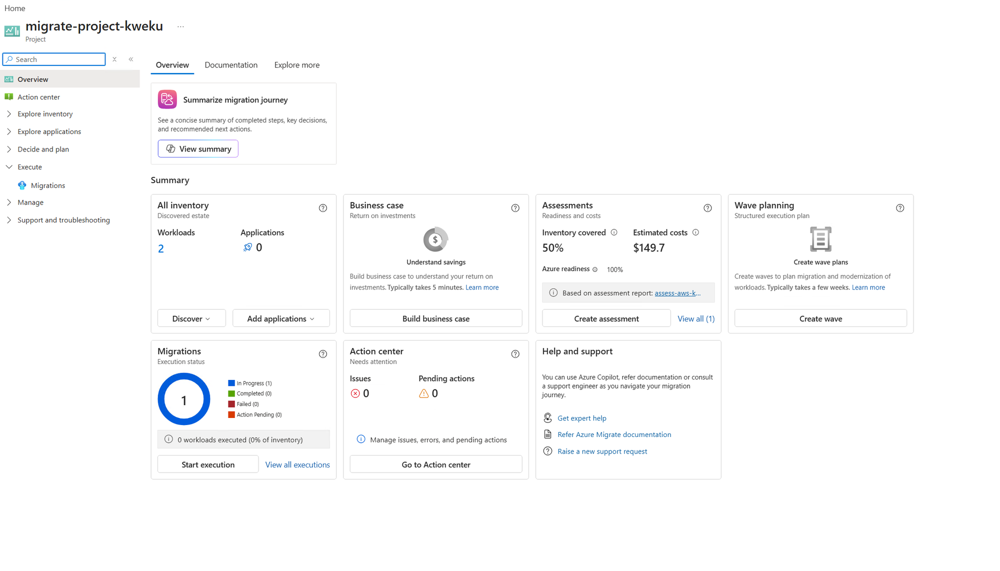


---

### Step 6: Set Up the Discovery Appliance

1. In the Migrate project, go to **Discover**, choose **Physical or other (AWS, GCP, etc.)**, name the appliance, and click **Generate key**. Save the key.
2. Remote Desktop into the discovery appliance EC2 instance. Download and extract the installer, then run `AzureMigrateInstaller.ps1` as Administrator and choose **Physical or other**, **Azure Public**, **Public endpoint**.
3. In the configuration manager that opens, paste the project key and sign in to Azure to register.
4. Add a credential: type **Windows Server**, user `Administrator`, and the source server's password.
5. Add the source server's **private IP** as the discovery source (both are in the same VPC), then click **Start discovery**.

*The configuration manager showing "Successfully registered.".*

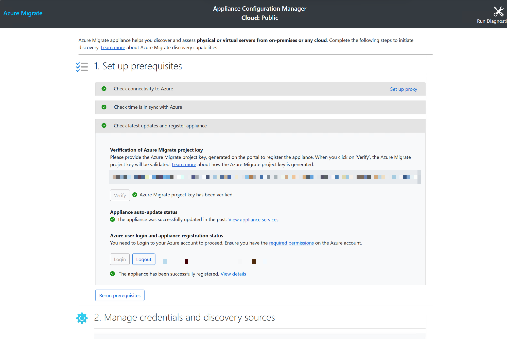

*Azure Migrate's discovered servers list with the source server in it.*

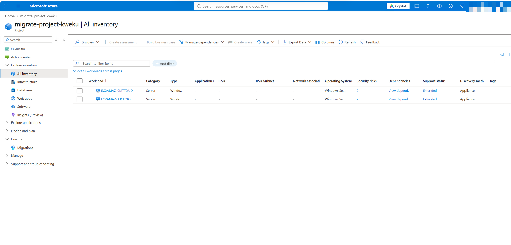


---

### Step 7: Run the Assessment

1. In the Migrate project, click **Assess → Azure VM**
2. Settings: East US, performance-based sizing, no reserved instances
3. Create a group called `aws-ec2-group`, add the source server, and create the assessment

What to look for:
- **Readiness:** "Ready for Azure" means no blockers. "Ready with conditions" or "Not ready" lists what needs fixing.
- **Recommended VM size** and **monthly cost estimate**

Skip **Create wave**. That's for moving hundreds of servers in batches.

*The readiness result.*

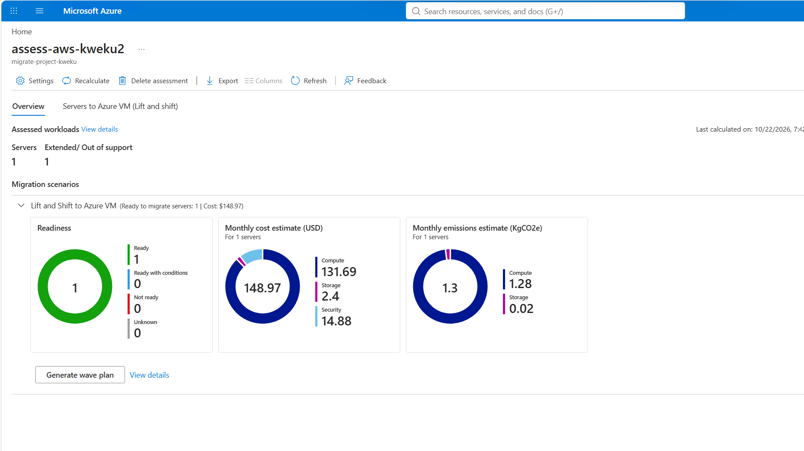

*The recommended size and cost estimate.*

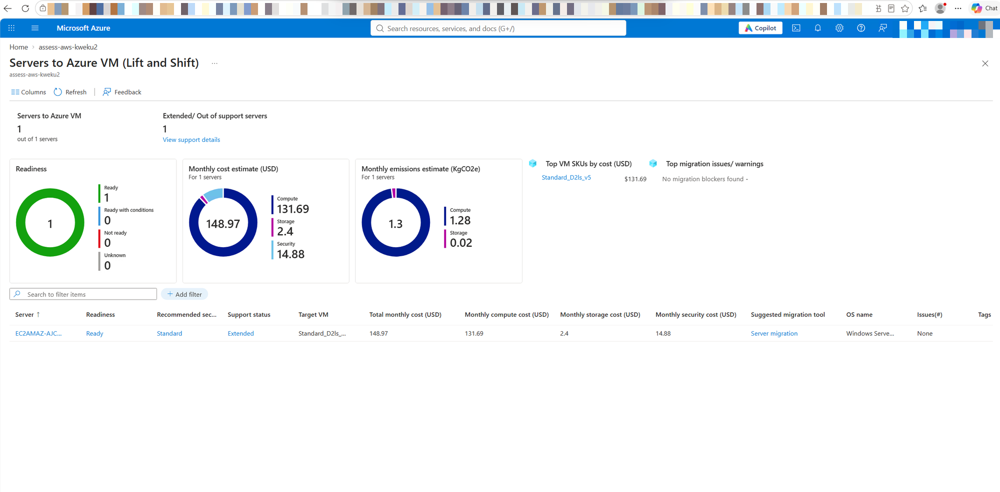


---

### Step 8: Set Up the Replication Appliance

1. In the Migrate project, go to **Migration and modernization → Discover**, choose **Physical or other**, target region East US, and click **Create resources**. Azure creates the vault it needs here.
2. There is no download button in the portal. The PowerShell installer comes from the documentation link (`aka.ms/V2ARcmApplianceCreationPowershellZip`). Download it on the replication server, extract it, and run `DRInstaller.ps1` from the **inner** folder as Administrator.
3. In the configuration manager: let the prerequisite checks pass (including the core count), choose **NAT IP** with the appliance's *private IP* (not FQDN, because EC2 Windows hostnames do not resolve between instances), register with the key using the device-code login, tick "I do not have vCenter", and add the source server under **Physical server details**.

Microsoft says the replication appliance can't be the same machine as the discovery appliance, which is why there are two.

*The replication appliance showing as connected.*

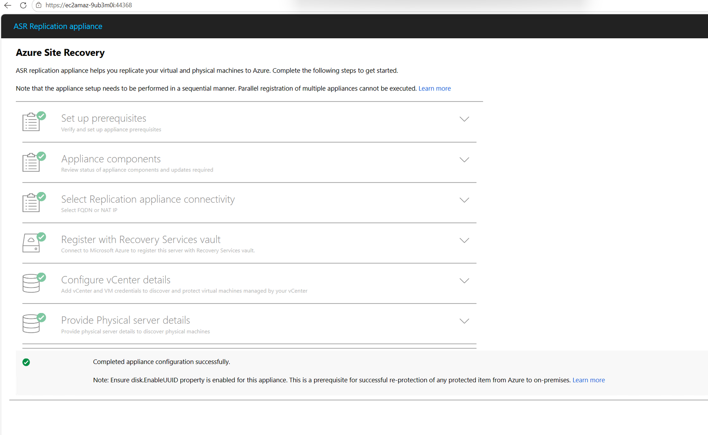


---

### Step 9: Let the Appliance Install the Mobility Service

With the current appliance there is nothing to install by hand. When you click **Replicate**, the replication appliance **pushes** the Mobility service to the source server over remote WMI and SMB.

That needs two things in place first:
- AWS: the source security group allows the replication appliance on ports 135, 445, 5985-5986 and 49152-65535 (a Terraform rule scoped to the appliance's security group only)
- Windows on the source: the WMI, DCOM and File and Printer Sharing firewall rules enabled, with the network profile set to Private

The agent is the part that sends disk changes. The job step "Installing Mobility Service and enabling replication" took about 19 minutes.

*The install completing on the source server.*

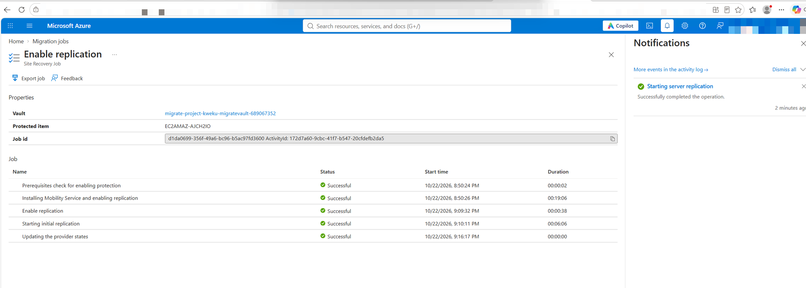


---

### Step 10: Start Replication

1. **Migration and modernization → Replicate**
2. Choose **Physical or other**, pick the replication appliance, and select the source server
3. Target: `rg-migrate-target-kweku`, storage `stmigratekweku`, VNet `vnet-migrate-kweku`, subnet `snet-migrate`
4. Leave the cache storage on auto-create and Hybrid Benefit unticked, then click **Replicate**. The size and test network can only be changed after the first recovery point exists (status **Protected**), so edit them then

The first full copy takes roughly 30–60 minutes for a 30 GB disk. Wait for the status to change from **Initial replication** to **Protected**.

*The replicating machines list showing progress.*

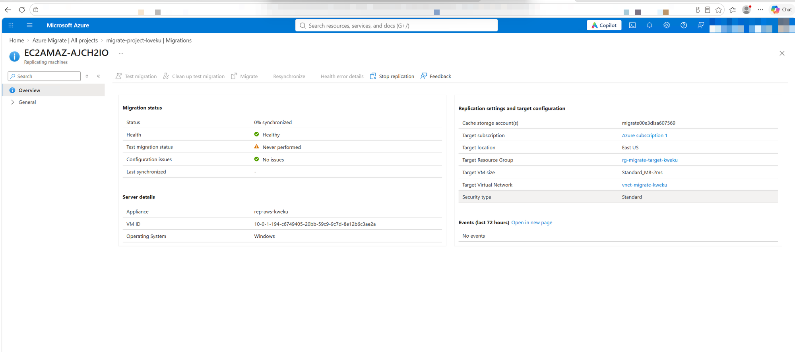

*The item healthy with the test migration time and a recent "Last synchronized" time (replication keeps running after the test).*

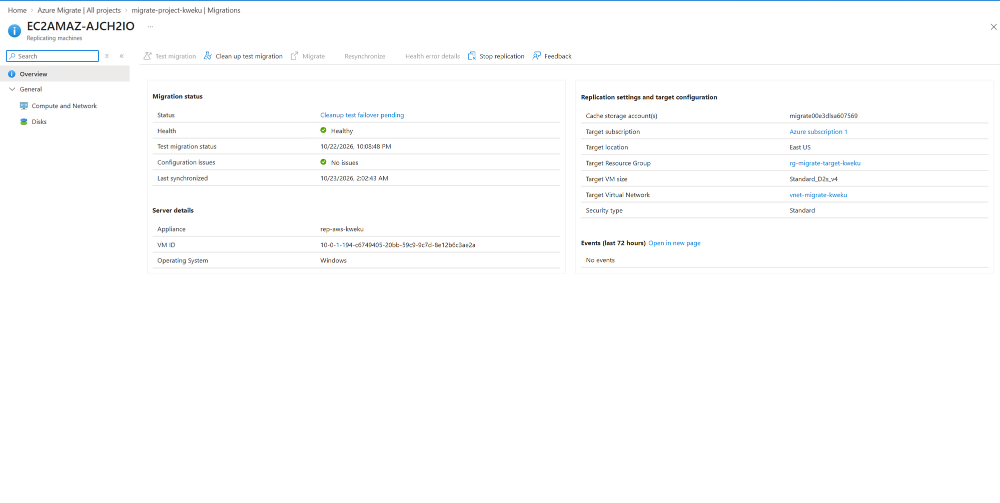


---

### Step 11: Run a Test Migration

1. Open the replicating server and click **Test migration**, using `vnet-migrate-kweku`
2. When the test VM appears, connect to it and confirm Windows boots and the hostname matches
3. Click **Clean up test migration**

If the test fails, read the reason from the job's task detail. Mine failed because the size I chose could not boot a Generation 1 VM (see Troubleshooting).

This is the dress rehearsal. Skipping it in a real migration is how outages happen.

*The item showing the test migration time and a healthy status.*

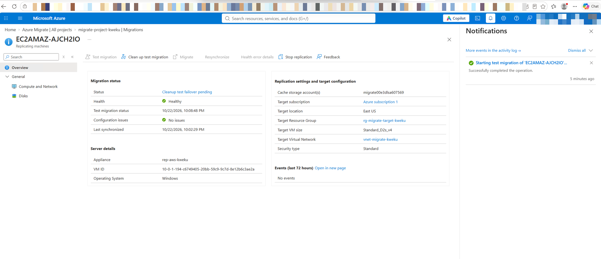


---

### Step 12: Cut Over

1. Open the replicating server and click **Migrate**
2. For a lab, choose **No** on shutting down the source, so you can compare both servers. In production you'd choose **Yes**: it shuts the source down, copies the last changes (no data loss), and avoids two live copies.

*The item showing **Failover completed**.*

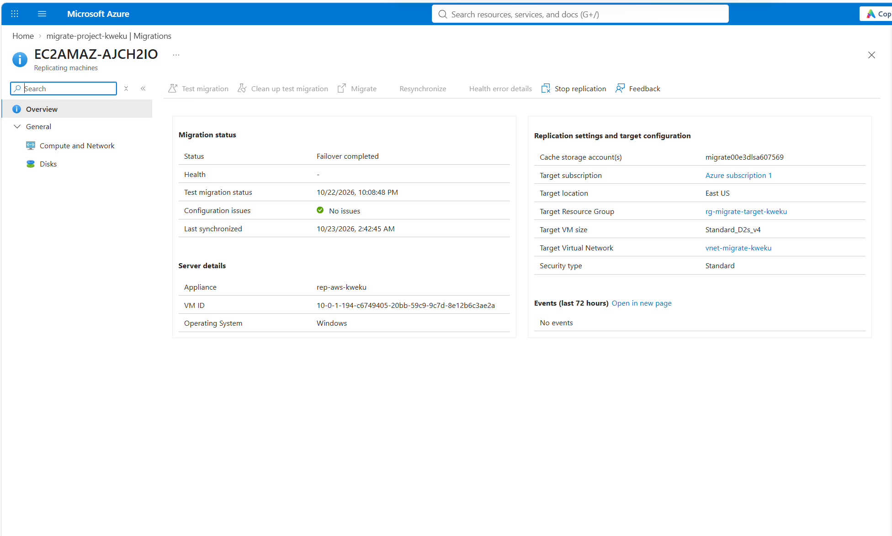


---

### Step 13: Verify the Migrated VM

1. In `rg-migrate-target-kweku`, find the new VM
2. Attach a public IP and the NSG `nsg-migrate-target-kweku` to its network interface
3. Connect with Remote Desktop using the original `Administrator` password
4. Confirm the hostname and OS version match what you noted in Step 3

The IP address will be different from AWS. That's expected when changing clouds.

*The migrated VM's **System → About** page, side by side with Step 3's screenshot if possible. This is the most important screenshot in the project.*

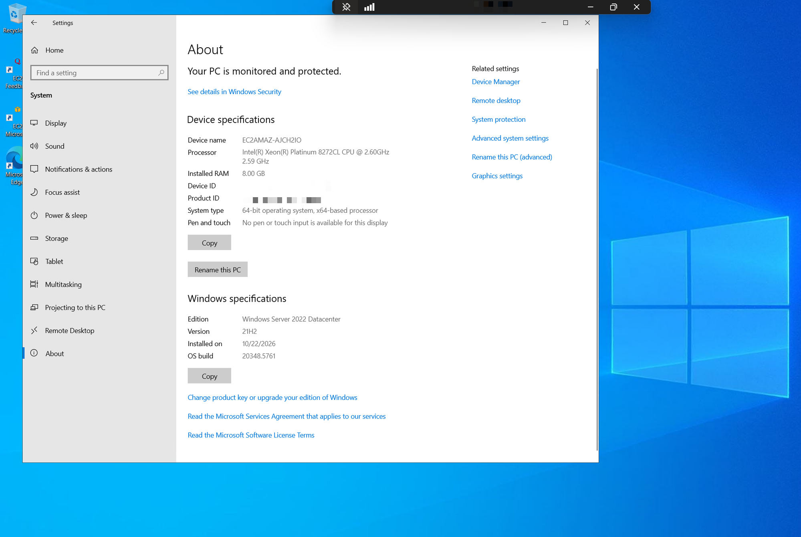

---

### Step 14: Tear Everything Down

Order matters:

1. **Stop replication** in Azure Migrate and wait for it to confirm
2. `terraform destroy` in `aws-side`
3. Delete `rg-migrate-target-kweku` (it holds the migrated VM, which Terraform doesn't track)
4. `terraform destroy` in `azure-side`
5. Delete the Azure Migrate project and the vault Azure created, if they remain

Two things blocked the Azure delete, and both are worth knowing:
- **A resource lock.** Azure Migrate puts a `CanNotDelete` lock on the cache storage account it creates. Remove the lock (`az lock delete`) before deleting the resource group.
- **MFA.** With Entra security defaults on, the CLI refuses deletes until you sign in again with MFA (`az login --use-device-code`).


*`Destroy complete!` for AWS.*

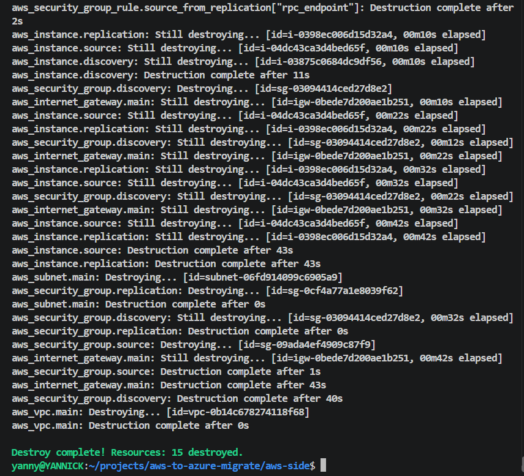

`terraform destroy` removed all 15 AWS resources (three servers, the VPC, subnet, internet gateway, route table, security groups and rules). I then checked the account: 0 servers, 0 disks, 0 networks left.

After the deletes, the subscription's resource groups were `NetworkWatcherRG` (created by Azure) and `rg-lab05-kweku` (a different lab). Both migrate groups were gone.

---

## Results

| Check | Result |
|---|---|
| Source server discovered | ✅ EC2AMAZ-AJCH2IO, Windows Server 2022, 29 GB disk, BIOS boot |
| Assessment readiness | ✅ Ready, no migration blockers (Windows support status: Extended) |
| Recommended Azure VM size | Standard_D2ls_v5 |
| Estimated monthly cost in Azure | **$148.97** (compute 131.69, storage 2.40, security 14.88), with Hybrid Benefit off |
| Time for initial replication | about 12 minutes of copying, then about 20 minutes to the first recovery point (Protected at 6:48 PM EDT) |
| Test migration booted | ✅ Hostname EC2AMAZ-AJCH2IO, Windows Server 2022 build 20348.5761, Azure VM agent Ready |
| Cutover completed | ✅ "Failover completed", job took about 2.5 minutes (chose **No** on shutting down the source so both copies stayed up for comparison) |
| Hostname and OS match source | ✅ Final VM: hostname EC2AMAZ-AJCH2IO, Windows Server 2022 Datacenter 21H2, build 20348.5761, the same as the AWS source. Only the hardware differs (8 GB RAM on D2s_v4) |
| Teardown | ✅ AWS: 0 servers, 0 disks, 0 networks left. Azure: both migrate resource groups deleted |
| Cost of the lab (AWS + Azure) | about $32 projected from hourly rates and run times (not a bill, see the Cost section) |

---

## Project Breakdown

A plain-language summary of what this project was, why it matters, and what I would do differently.

### What I did

I moved a live Windows Server 2022 from AWS to Azure using Microsoft's migration service, Azure Migrate, and built both sides with Terraform.

1. **Discover.** A helper server scanned the machine and reported its details to Azure.
2. **Assess.** Azure judged the machine **Ready** with no blockers, and estimated about **$148.97 a month**.
3. **Replicate.** A second helper copied the disk to Azure while the original kept running.
4. **Test.** Azure built a temporary copy and booted it, without touching the real server.
5. **Cut over.** Azure built the real VM. It came up with the **same hostname, edition and build number (20348.5761)** as the AWS original, which is the main proof the move worked.
6. **Tear down.** Both clouds were removed in the right order so nothing kept billing.

### Why it matters

- Moving servers between clouds is routine work: after acquisitions, for cost, or for compliance.
- It shows a process (discover, assess, test, cut over), not just clicking through a wizard.
- Everything is code and documented, so someone else can rebuild it from this repo.
- The cleanup was done and verified, which is often skipped.

### An alternative approach

- **Agentless migration** needs nothing installed on the source, but Azure Migrate does not offer it for AWS servers. It treats them as physical machines, which is why this project is agent-based.
- **Rebuild instead of move.** For an app with a clean install process, redeploying on a fresh Azure VM (or containers) is often better long term, but it needs deep knowledge of the app.
- **At larger scale,** group servers into waves and connect the clouds with a VPN so machines can talk during the move.

### What I learned

The hard part was not the wizard. It was finding the real cause behind generic errors, at the right layer each time.

- **Vendor requirements are literal.** The replication appliance counts physical cores, so a size with "8 vCPUs" still failed.
- **Check the firewall at every hop.** Three separate blocks looked like three different errors.
- **Read the real log.** The portal said "internal error". The answer was in the Push Install Agent log and the job's task detail.
- **BIOS or UEFI decides the Azure VM generation,** which limits the sizes that can boot.
- **New accounts hit quotas in both clouds** (5 vCPUs on AWS, 4 on Azure).
- **A test migration is where the surprises show up cheaply.**

### Honest numbers

- **Time:** about a full day, mostly troubleshooting.
- **Cost:** about $32 for the whole lab, projected from hourly rates and run times (not a bill). Separately, the assessment's $148.97 per month is the estimated cost of running the migrated VM, and it includes the Windows license because Hybrid Benefit was off.

---

## Security Decisions

- **RDP limited to my IP.** Open RDP to the internet is one of the most scanned ports. Even for a short lab, there's no reason to allow it from everywhere.
- **Only the ports the migration needs.** WinRM (5985) for discovery and 443/9443 for replication, each allowed only from the specific appliance that uses it.
- **No AWS access keys.** Azure Migrate doesn't need them for AWS servers, so creating them would just add a long-lived credential that could leak.
- **Passwords stay out of Git.** `terraform.tfvars` and state files are in `.gitignore`. State files can contain sensitive values.
- **Test before cutover.** A test migration confirms the server boots in Azure before anything is committed.
- **Separate staging and target resource groups.** Migration tooling can be deleted without touching the migrated VM.
- **Extra source-server rules are scoped to one security group.** The replication appliance's group can reach the source on the migration ports. Nothing is opened to the internet.
- **Screenshots are redacted.** Subscription IDs, account emails, project keys and public IPs are blurred.

---

## Troubleshooting / Common Issues

Every row here is something I hit or checked while building this. They are grouped by where the problem showed up.

### Accounts and quotas
| Issue | Cause | Fix |
|---|---|---|
| `VcpuLimitExceeded` when launching on a new AWS account | New accounts allow only 5 Standard vCPUs | Request an increase in Service Quotas (mine was approved at 32) |
| Azure target size shows `Standard_M8-2ms` | Wizard default, and it is above a 4-vCPU Azure quota | Edit it to a 2-vCPU size once the status is Protected |

### Terraform and AWS
| Issue | Cause | Fix |
|---|---|---|
| `cannot begin with sg-` | AWS reserves that prefix for its own IDs | Name the group `migrate-source-sg-kweku` |
| `collecting instance settings: empty result` | AMI ID doesn't exist in your region | Look up the latest Windows Server 2022 AMI with `aws ec2 describe-images` and update `windows_ami` |
| `azurerm_migrate_project` not supported | Terraform's Azure provider can't create Migrate projects | Create the project in the portal (Step 5) |
| Terraform shows the source security group changing on the next plan | Inline rules and separate rule resources conflict | Define every rule for that group as a separate rule resource, as the code now does |

### Appliances and installers
| Issue | Cause | Fix |
|---|---|---|
| Replication appliance: "Memory and CPU validation failed ... only 4 CPU cores" | `c5.2xlarge` has 8 vCPUs but only 4 physical cores | Resize to `c5.4xlarge` (16 vCPUs, 8 cores) |
| Configuration manager link gives `DNS_PROBE_FINISHED_NXDOMAIN` from another server | Windows computer names do not resolve between EC2 instances | Use the private IP (the NAT IP option) |

### Networking and firewalls
| Issue | Cause | Fix |
|---|---|---|
| Discovery validation fails | WinRM blocked, or wrong password | Check the security group allows 5985 from the discovery appliance, and re-enter the credential |
| Physical server status **Error** in the replication appliance | The source security group only allowed port 5985 from the discovery appliance | Add rules from the replication appliance's group: 135, 445, 5985-5986, 49152-65535 |
| Replication stuck at 0% | The source can't reach the replication appliance | Confirm 443 and 9443 are allowed from the source to the replication appliance |

### Replication and migration
| Issue | Cause | Fix |
|---|---|---|
| Source server missing from the Replicate list | The appliance could not validate the server | Fix the firewall rules above, then re-add the server in the appliance until it shows Success |
| Job fails at "Installing Mobility Service" (codes 539 and 320000) | The push stopped at the remote WMI step, so the agent was never installed | Enable the WMI-In and DCOM-In rules, set the network profile to Private, retry. Log: `C:\Program Files\Microsoft Azure Push Install Agent\PushInstallService.log` |
| Test migration fails: `VM size 'Standard_D2ls_v7' cannot boot Hypervisor Generation '1'` | A BIOS source becomes a Generation 1 VM | Use a size that supports Gen 1 (D2s_v4) |
| Portal shows "In error / Action pending" after a failed test | Health 161011: no successful test migration yet | Clean up the failed test, fix the size, run the test again |

### After cutover and during teardown
| Issue | Cause | Fix |
|---|---|---|
| Can't RDP to the migrated VM | No public IP or no NSG on its network interface | Attach both (Step 13) |
| Migrated VM has a different IP | Azure assigns a new address | Expected. Update DNS if anything points to the old IP |
| `ScopeLocked` when deleting the staging resource group | Azure Migrate puts a `CanNotDelete` lock on its cache storage account | Remove it with `az lock delete`, then delete the group |
| `RequestDisallowedByAzure` ... MFA | Entra security defaults require MFA for deletes, and the CLI sign-in did not have it | `az login --use-device-code` and approve the MFA prompt, or delete in the portal |
| `vault is not empty` on destroy | Replication items still registered | Stop replication and remove items from the vault, then retry |

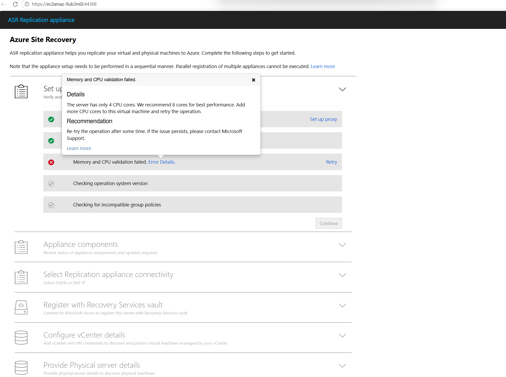

---

## Key Takeaways

What this project taught me, in short:

- **A migration is a process, not a button.** Discover, assess, replicate, test, cut over. Each step catches a different kind of problem.
- **Assessment is where you find blockers cheaply.** Fixing a "Not ready" result before replication saves hours.
- **Network paths decide whether it works.** The source server has to reach the replication appliance. Getting the firewall rules and placement right matters more than any setting in the portal.
- **Always test first.** A test migration costs minutes. A failed cutover can cost a day of downtime.
- **Clean up in order.** Two clouds and several manual resources mean `terraform destroy` alone won't catch everything.
- **Read the real log and the real error.** Several problems here had a generic message in the portal and the answer somewhere else. See Project Breakdown for the full list.

---

## Reference

- [Microsoft: Discover, assess, and migrate AWS VMs to Azure](https://learn.microsoft.com/azure/migrate/tutorial-migrate-aws-virtual-machines)
- [Microsoft: Migrate machines as physical servers to Azure](https://learn.microsoft.com/azure/migrate/tutorial-migrate-physical-virtual-machines)
- Base lab guide: *Azure Migration Lab: AWS EC2 to Azure using Azure Migrate*

---
**Author:** Manuel Yannick Armah

**Project:** Migrating a Windows Server from AWS to Azure with Azure Migrate

**Difficulty:** Intermediate

**Time to Complete:** about a full day (most of it troubleshooting)
